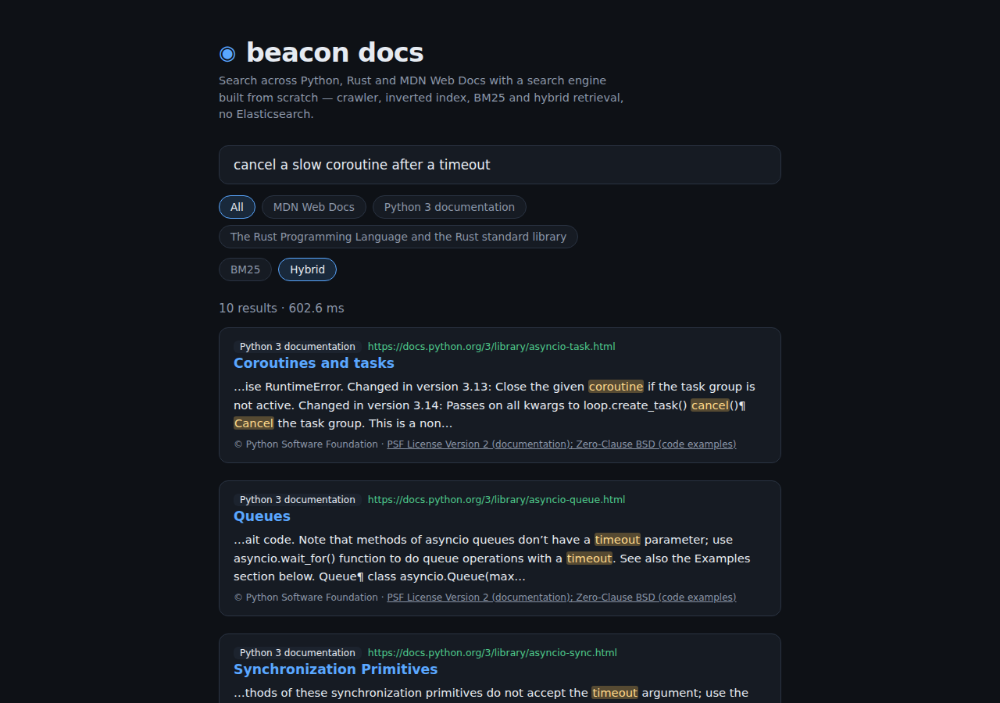

# beacon-search-console

**Project 10/10 of the [`beacon-search-engine`](https://github.com/juanmmm21/beacon-search-engine) ecosystem** — the flagship application.
Repository: [`github.com/juanmmm21/beacon-search-console`](https://github.com/juanmmm21/beacon-search-console)

A complete, working search engine console — FastAPI backend + React/TypeScript
frontend — that assembles the nine infrastructure pieces of the ecosystem into
one product and runs them over a **real corpus**: 181 pages crawled live from
`docs.python.org/3` (tutorial + library reference), indexed, compressed,
partitioned into shards, and served with BM25 + PageRank + learning-to-rank
reranking, live autocomplete, spell correction, and highlighted snippets. No
Elasticsearch, no Lucene, no search SaaS anywhere in the stack: every layer
underneath this app is one of the ecosystem's own from-scratch projects.

It also ships **Beacon Docs**, a public search product over curated technical
documentation (Python, Rust, MDN Web Docs) with a versioned JSON API, an MCP
server for agents, hybrid retrieval and a measured relevance evaluation on
BEIR — see [Beacon Docs](#beacon-docs-the-public-documentation-search) and
[Relevance evaluation](#relevance-evaluation).



## What problem it solves

Each of the nine previous projects proves one piece of search infrastructure
in isolation: a polite crawler, a boilerplate-stripping extractor, a
positional inverted index, a postings compression codec, a BM25 scorer, a
PageRank implementation, a gradient-boosted reranker, a query parser with
autocomplete, and a sharded fan-out/merge layer. None of them, alone, is a
search engine. This project is the proof that the ecosystem composes: it
wires all nine together — through the exact on-disk contracts and package
APIs each of them documents — into a product a person can actually use, over
content crawled from the real web, with the failure modes of a real system
(a shard process dying mid-session) handled visibly instead of crashing.

## Role in `beacon-search-engine`

```text
                     OFFLINE (scripts/bootstrap_corpus.sh)
┌──────────────────────────────────────────────────────────────────────────────┐
│ web-crawler-scheduler ──▶ filter_corpus_domain.py ──▶ html-content-extractor │
│    │ link_graph.jsonl        │ documents.jsonl (main_text)                   │
│    │                         ▼                                               │
│    │                         inverted-index-builder                          │
│    │                         │ index/ (postings + stats)                     │
│    │                         ▼                                               │
│    │                         index-compression-codec                         │
│    │                         │ compressed index                              │
│    ▼                         ▼                                               │
│ pagerank-link-analysis   distributed-index-sharding `partition`              │
│    │ pagerank_scores         │ shard-0/ .. shard-N/                          │
│    └──────────┐              │       learning-to-rank-reranker               │
│               │              │            │ trained model                    │
└───────────────┼──────────────┼────────────┼──────────────────────────────────┘
                ▼              ▼            ▼
                 ONLINE (this project)
┌──────────────────────────────────────────────────────────────────────────────┐
│  FastAPI backend                                                             │
│    query ─▶ query-parser-autocomplete (parse + spellcheck)                   │
│          ─▶ distributed-index-sharding (fan-out to N shard                   │
│             processes, each scoring with bm25-ranking-engine,                │
│             k-way merge, tolerance to shard failure)                         │
│          ─▶ learning-to-rank-reranker (BM25 + PageRank + match               │
│             features, grouped per shard — see Architecture)                  │
│          ─▶ snippets from html-content-extractor's documents.jsonl           │
│                                                                              │
│  React + TypeScript frontend                                                 │
│    debounced search · live autocomplete · highlighted snippets ·             │
│    index stats panel · explicit shard-degradation banner                     │
└──────────────────────────────────────────────────────────────────────────────┘
```

This is where the whole ecosystem converges — the app every other README
refers to as "converges in `beacon-search-console`".

## Goal and skills demonstrated

- **Orchestration, not reimplementation**: this app contains no tokenizer, no
  scorer, no ranking formula of its own. Parsing and autocomplete come from
  [`query-parser-autocomplete`](https://github.com/juanmmm21/query-parser-autocomplete),
  distributed scoring from
  [`distributed-index-sharding`](https://github.com/juanmmm21/distributed-index-sharding)
  (which delegates BM25 to
  [`bm25-ranking-engine`](https://github.com/juanmmm21/bm25-ranking-engine)
  inside each shard process), and the final ordering from
  [`learning-to-rank-reranker`](https://github.com/juanmmm21/learning-to-rank-reranker)
  combining BM25 with the authority scores of
  [`pagerank-link-analysis`](https://github.com/juanmmm21/pagerank-link-analysis).
  The backend's own code is glue: configuration, lifecycle, one integration
  bridge (below), and snippet presentation.
- **The one integration no other repo could own**: `distributed-index-sharding`
  merges per-shard BM25 results but knows nothing about reranking;
  `learning-to-rank-reranker` reranks against a single index directory but
  knows nothing about shards. Bridging them — grouping merged candidates by
  the shard that owns each `doc_id`, reranking per shard against that shard's
  local index, then re-merging with the ecosystem's standard deterministic
  tie-break — is exactly the kind of composition problem a flagship app
  exists to solve (`backend/src/beacon_search_console/reranking.py`).
- **Real corpus, reproducible bootstrap**: `scripts/bootstrap_corpus.sh` runs
  the six offline tools end to end against `docs.python.org` (allowed by its
  `robots.txt`, crawled with the polite rate-limiting
  [`web-crawler-scheduler`](https://github.com/juanmmm21/web-crawler-scheduler)
  enforces) — no canned fixtures in production, no fake data in the demo.
  `web-crawler-scheduler` has no domain-restriction flag of its own (it's a
  reusable crawling primitive, not scoped to any one corpus), so a crawl at
  `--max-depth 2` legitimately follows outbound links off `docs.python.org`
  (permalinks into `github.com/python/cpython`, mostly); `scripts/filter_corpus_domain.py`
  is this project's own intermediate step — never a change to the crawler
  itself — that keeps only the seed domain's pages before extraction, so the
  indexed corpus is exactly the "real corner of the web" this app set out to
  serve, not everything the crawl happened to reach.
- **Failure handled as a feature**: killing a shard process mid-session
  degrades the response (`degraded: true`, per-shard statuses, partial
  results from the healthy shards) instead of returning a 500 — surfaced in
  the UI as an explicit banner naming which shard is down and why.
- **Typed on both sides of the wire**: `mypy --strict` on the backend,
  TypeScript `strict` (plus `noUncheckedIndexedAccess`) on the frontend, and
  a hand-mirrored contract (`frontend/src/types/api.ts` ↔
  `backend/src/beacon_search_console/models.py`) for the versioned
  `/api/v1` API.

## How it works

A search request flows through the backend like this:

1. **Parse + spellcheck** — the raw string is parsed by
   `query-parser-autocomplete` (`parse_and_correct_query`): exact phrases,
   `-exclusions`, `site:` filters, and typo correction against the *global*
   index vocabulary (built once at startup from the unpartitioned index —
   shard-local vocabularies would miss corrections for terms living on other
   shards).
2. **Fan-out** — the resulting `ParsedQuery` JSON is handed to
   `DistributedSearchPipeline.search_parsed_query`, which asks every shard
   process concurrently over HTTP; each shard scores with its own
   `bm25-ranking-engine` instance and applies exclusions/`site:` filters
   locally. The coordinator k-way-merges the healthy shards' results and
   reports the failed ones — it never raises because a shard died.
3. **Rerank** — the merged candidates (over-fetched: `limit × 3` by default,
   so the reranker has real freedom to reorder) go through the
   sharding↔reranking bridge described above, producing the final order from
   BM25, PageRank, and index-derived match features.
4. **Snippets** — the ranked `doc_id`s are resolved back to real text. The
   indexing chain deliberately drops `main_text` (an index stores postings,
   not prose), so the backend loads `html-content-extractor`'s
   `documents.jsonl` at startup and correlates by `doc_id` = line number —
   the exact contract `inverted-index-builder` documents. A window around
   the first match is returned as plain text plus character-offset highlight
   ranges; the frontend wraps those ranges in `<mark>` itself (never
   `dangerouslySetInnerHTML` with server-built HTML).

Autocomplete (`/api/v1/autocomplete`) delegates to
`query-parser-autocomplete`'s two-trie suggester, built once at startup from
the global vocabulary (plus an optional query log). Index stats
(`/api/v1/index/stats`) read the builder's `stats.json`, the cluster
manifest, and the most recent `fetched_at` in the extractor's output.

## Architecture

```text
beacon-search-console/
├── scripts/
│   ├── bootstrap_corpus.sh       # offline pipeline: crawl → filter domain →
│   │                             # extract → index → compress → pagerank →
│   │                             # partition → train LTR
│   ├── filter_corpus_domain.py   # keeps only the seed domain's pages
│   │                             # (web-crawler-scheduler has no domain
│   │                             # restriction of its own, see Goal above)
│   └── tests/                   # unittest, stdlib only, no extra dependency
├── data/                      # bootstrap output (gitignored, reproducible)
├── samples/tiny_corpus/       # 5-doc deterministic fixture for backend tests
├── backend/
│   ├── pyproject.toml         # installs the 3 real package dependencies
│   └── src/beacon_search_console/
│       ├── config.py          # env-configurable paths/params (BEACON_*)
│       ├── models.py          # the API's own response contract
│       ├── dependencies.py    # AppState: everything opened once per process
│       ├── app.py             # FastAPI app + lifespan + /api/v1 routers
│       ├── reranking.py       # the sharding ↔ reranking bridge
│       ├── snippets.py        # doc_id → real text, highlight ranges
│       ├── index_stats.py     # minimal reader of the builder's stats.json
│       └── routes/            # search.py, autocomplete.py, stats.py
└── frontend/
    └── src/
        ├── api/client.ts      # typed fetch client for /api/v1
        ├── types/api.ts       # TS mirror of the backend contract
        ├── components/        # SearchBox (with autocomplete dropdown),
        │                      # SearchResults, SnippetText, StatsPanel,
        │                      # ShardStatusBanner — each with a Vitest +
        │                      # Testing Library test alongside it
        ├── hooks/useDebouncedValue.ts  # + its own debounce unit test
        └── App.tsx            # debounced search, ?q= URL sync
```

Two deliberate architecture decisions:

- **Offline/online separation.** The six tools that build artifacts (crawler,
  extractor, index builder, codec, PageRank, partitioner + LTR training) are
  installed into a disposable `.bootstrap-venv/` by the bootstrap script and
  never imported by the backend. The backend's own venv installs only the
  three packages the *online* path genuinely needs to call in-process:
  `distributed-index-sharding`, `query-parser-autocomplete`, and
  `learning-to-rank-reranker` (direct git-URL dependencies — the documented
  ecosystem exception for outputs that are in-memory only, first established
  by `bm25-ranking-engine`). Everything else is consumed through the on-disk
  formats each project documents.
- **Everything expensive opens once.** Shard subprocesses, the LightGBM
  model, the snippet table, the spellchecker, and the autocomplete tries are
  all built in the FastAPI lifespan and closed explicitly on shutdown —
  `DistributedSearchPipeline` owns the shard processes' lifecycle, so
  stopping the API stops the whole local cluster with it.

## Requirements

- Python `>=3.11`
- Node.js `>=20` (frontend)
- macOS: `brew install libomp` (LightGBM's OpenMP runtime, needed by
  `learning-to-rank-reranker`)
- The nine sibling repositories cloned next to this one (the bootstrap
  script installs the offline tools from the sibling folders; the backend
  installs its three package dependencies from GitHub)

## Bringing the whole engine up from scratch

```bash
git clone https://github.com/juanmmm21/beacon-search-console.git
cd beacon-search-console

# 1. Build the corpus and every artifact (crawls docs.python.org politely;
#    ~180 pages, a few minutes). Re-run anytime to refresh the corpus.
bash scripts/bootstrap_corpus.sh

# 2. Start the API (spawns one real shard process per shard and health-checks
#    them before serving).
cd backend
python3 -m venv .venv && source .venv/bin/activate
pip install -e ".[dev]"          # add ",hybrid" for the hybrid search and its evaluation
python -m beacon_search_console --port 8000

# 3. Start the UI (proxies /api to :8000).
cd ../frontend
npm install
npm run dev            # → http://localhost:5173
```

`MAX_PAGES`, `MAX_DEPTH` and `NUM_SHARDS` tune the bootstrap
(`MAX_PAGES=400 NUM_SHARDS=4 bash scripts/bootstrap_corpus.sh`). The backend
reads its paths and parameters from `BEACON_*` environment variables
(`config.py` documents each one); by default everything points at `data/`.

## Quick start if the corpus is already bootstrapped

If `data/` (the bootstrap output), `backend/.venv` and `frontend/node_modules`
already exist from a previous run, there is no need to repeat step 1 above —
the corpus doesn't change until `scripts/bootstrap_corpus.sh` is run again, so
just start the two long-running processes directly:

```bash
# Terminal 1 — API (spawns the real shard subprocesses on startup)
cd backend
source .venv/bin/activate
python -m beacon_search_console --port 8000

# Terminal 2 — UI
cd frontend
npm run dev            # → http://localhost:5173
```

Open `http://localhost:5173`, type a query (e.g. `python tutorial`), and the
results, snippets and index-stats panel are all live against the real corpus.

**Manually forcing shard degradation** — the same check the automated tests
and the manual smoke test both cover, but doable by hand against the real,
running cluster: kill one of the shard subprocesses `DistributedSearchPipeline`
started and confirm the next search degrades instead of failing.

```bash
# 1. Find the shard processes and their PIDs — one per configured shard
#    (default 3), each running distributed_index_sharding's own serve-shard.
ps aux | grep serve-shard | grep -v grep

# Example output (PID in the second column, --shard-id near the end):
# golfeno  18101  ...  serve-shard .../data/shards/shard-0 --shard-id 0 ...
# golfeno  18102  ...  serve-shard .../data/shards/shard-1 --shard-id 1 ...
# golfeno  18103  ...  serve-shard .../data/shards/shard-2 --shard-id 2 ...

# 2. Kill one shard by its PID (shard 1 in this example)
kill -9 18102

# 3. Search again — either in the UI, or directly against the API:
curl -s "http://127.0.0.1:8000/api/v1/search?q=python%20tutorial&limit=3" | python3 -m json.tool
```

The response comes back with `"degraded": true`, a `message` naming how many
shards failed to respond, and a `shard_statuses` entry with `"status": "error"`
for the killed shard (a connection-refused error, not a timeout, since the
process is simply gone) — the other shards' results still populate `results`.
In the UI, the same information renders as the amber "Índice degradado" banner
(`ShardStatusBanner`) listing every shard's status, with the surviving
results still shown underneath it. Restarting the API respawns a fresh,
healthy cluster; there's nothing to clean up on the killed shard itself.

## API

The contract is versioned under `/api/v1` from the first commit. All
endpoints are `GET`.

| Endpoint | Parameters | Returns |
|---|---|---|
| `/api/v1/search` | `q` (query text), `limit` (1–50, default 10) | Ranked results with `url`, `title`, `score`, and a `snippet` (`text` + `highlights` as `{start, end}` character ranges); applied spelling `corrections`; per-shard `shard_statuses`; `degraded` flag and a human-readable `message` when the query was empty, matched nothing, or ran against a partially-down cluster |
| `/api/v1/autocomplete` | `q` (prefix), `limit` (1–20, default 8) | Ranked `suggestions` (`text`, `score`); an empty prefix returns the most frequent queries, `query-parser-autocomplete`'s documented "trending" default |
| `/api/v1/index/stats` | — | `total_documents`, `vocabulary_size`, `total_postings`, `average_document_length`, `num_shards`, `last_crawled_at` (most recent `fetched_at` in the corpus) |

A shard failing mid-query never produces a 500: the response arrives with
`degraded: true`, the failing shard's `status`/`error_message` in
`shard_statuses`, and results from the surviving shards.

## Relevance evaluation

`eval/` and `backend/src/beacon_search_console/evaluation/` measure ranking
quality on public BEIR collections with the same components the console
serves: the corpus is rewritten as `html-content-extractor` documents,
indexed by `inverted-index-builder`, scored by `bm25-ranking-engine`,
reranked by `learning-to-rank-reranker`, and the hybrid systems run
`hybrid.py`, the same module the docs product uses. Test split, all test
queries, retrieval depth 100.

```bash
python -m beacon_search_console.evaluation run --dataset scifact \
  --systems bm25,bm25+ltr-qrels,dense-hnsw,bm25+dense-rrf,hybrid-rrf+ce \
  --output eval/results/scifact.json
```

| Collection | System | nDCG@10 | MRR@10 | Recall@100 |
|---|---|---|---|---|
| SciFact (5,183 docs, 300 queries) | BM25 | 0.6646 | 0.6340 | 0.8859 |
| | BM25 + LTR (synthetic model the console ships) | 0.6521 | 0.6205 | 0.8859 |
| | BM25 + LTR (trained on the train qrels) | 0.6746 | 0.6445 | 0.8859 |
| | Dense (MiniLM + HNSW) | 0.6417 | 0.6014 | 0.9217 |
| | BM25 + dense, RRF | 0.6811 | 0.6403 | 0.9543 |
| | **Hybrid: RRF + cross-encoder** | **0.6840** | **0.6509** | **0.9543** |
| NFCorpus (3,633 docs, 323 queries) | BM25 | 0.3100 | 0.5192 | 0.2354 |
| | BM25 + LTR (synthetic) | 0.3024 | 0.5084 | 0.2354 |
| | BM25 + LTR (train qrels) | 0.3112 | 0.5251 | 0.2354 |
| | Dense (MiniLM + HNSW) | 0.3092 | 0.4940 | 0.3101 |
| | BM25 + dense, RRF | 0.3397 | 0.5414 | 0.3249 |
| | **Hybrid: RRF + cross-encoder** | **0.3526** | **0.5814** | **0.3249** |
| FiQA-2018 (57,638 docs, 648 queries) | BM25 | 0.2334 | 0.2890 | 0.5075 |
| | BM25 + LTR (synthetic) | 0.2271 | 0.2884 | 0.5075 |
| | BM25 + LTR (train qrels) | 0.2297 | 0.2905 | 0.5075 |
| | Dense (MiniLM + HNSW) | 0.3509 | 0.4296 | 0.6761 |
| | BM25 + dense, RRF | 0.3317 | 0.4045 | 0.6859 |
| | **Hybrid: RRF + cross-encoder** | **0.3651** | **0.4387** | **0.6859** |

Measured on 2026-11-04/05 on an AMD Ryzen 7 7700X (WSL2, 7.3 GiB RAM) with an
RTX 5060 for the transformer models, Python 3.12.3, NumPy 2.5.4, LightGBM
4.7.0, PyTorch 2.11.0, transformers 5.22.1, from the `feat/beacon-roadmap`
branches of every component. The full reports, with timings and notes, are in
`eval/results/*.json`.

How to read it:

- **PageRank does not apply**: BEIR documents have no links between them, so
  there is no graph to compute it on; the LTR feature is 0 for every
  document, the same value an unlinked page gets in production.
- **The LTR model the console ships hurts** on all three collections: it is
  trained on synthetic data. Trained on each collection's own judgments it
  helps a little on SciFact and NFCorpus and still loses on FiQA. LTR only
  reorders BM25's top 100, so its Recall@100 is BM25's by construction.
- **Hybrid wins everywhere on nDCG@10**: +0.019 on SciFact, +0.043 on
  NFCorpus and +0.132 on FiQA over BM25, with large Recall@100 gains (dense
  retrieval finds what lexical matching misses). On FiQA dense retrieval
  alone already beats BM25 by far; `all-MiniLM-L6-v2` was trained on a large
  mix of public question/answer data, so some overlap with these domains
  cannot be ruled out.
- **Not measured: MS MARCO.** A dev subset needs a passage collection of 8.8 M
  documents (or a sampled one, which changes the task); it was left out
  rather than reported on a convenient sample.
- **CI**: `.github/workflows/eval.yml` runs BM25 and BM25 + LTR on the first
  100 SciFact test queries and fails if any metric drops more than 0.005
  below `eval/baselines/ci.json`.

## Hybrid search

`backend/src/beacon_search_console/hybrid.py` is the only place in the
ecosystem that uses AI Core components, as package dependencies (the
`hybrid` extra):

- **Embeddings**: `SiameseTransformer` from
  [`contrastive-embedding-trainer`](https://github.com/juanmmm21/contrastive-embedding-trainer)
  (mean pooling + L2 normalization) loading
  `sentence-transformers/all-MiniLM-L6-v2`; a checkpoint fine-tuned with that
  repo's `EmbeddingTrainer` loads through the same class.
- **Vector index**: [`nano-vector-db`](https://github.com/juanmmm21/nano-vector-db)
  in HNSW mode (M=16, efConstruction=64, efSearch=128). Vectors are stored as
  `.npy` (dense index format v1: `vectors.npy`, `doc_ids.npy`,
  `manifest.json`) and the graph is rebuilt on load: nano-vector-db persists
  with pickle, which this ecosystem never passes between repos.
- **Fusion**: Reciprocal Rank Fusion (k = 60) of the BM25 and dense top 100.
  RRF only uses ranks, so an unbounded BM25 score is never added to a cosine
  similarity.
- **Rerank**: [`cross-encoder-reranker`](https://github.com/juanmmm21/cross-encoder-reranker)
  with `cross-encoder/ms-marco-MiniLM-L-6-v2` over the first 50 fused results
  (20 in the docs product). That component silently falls back to a lexical
  heuristic if the model cannot load; here that is an explicit error, so a
  number labelled "cross-encoder" always is one.

## Beacon Docs: the public documentation search

A search product over curated technical documentation, fed by
[`beacon-search-engine-at-scale`](https://github.com/juanmmm21/beacon-search-engine-at-scale):
its `vertical-crawl` crawls each source (`deploy/vertical-sources.json` there:
Python 3 docs, the Rust book and standard library, MDN Web Docs) within its
URL prefixes and page budget, honoring robots.txt and Crawl-delay, indexes it
incrementally, and `export-vertical` publishes a bundle this app loads and
**hot-reloads** when a new one appears. Every result carries its source's
license and attribution. Swift's book is listed but disabled: docs.swift.org
serves it as a client-rendered DocC app with no content in the HTML.

The run behind the screenshot: 1,200 pages crawled (400 per source) in 7
minutes, 1,198 indexed.

```bash
# Run it against a bundle exported by beacon-search-engine-at-scale
BEACON_DOCS_BUNDLE_ROOT=/path/to/bundles beacon-search-console --port 8001 docs
BEACON_DOCS_HYBRID=1 ...   # also load the embedding and cross-encoder models
cd frontend && npm run dev  # open http://localhost:5173/docs.html
```

### Public API (`/v1`)

| Endpoint | Parameters | Returns |
|---|---|---|
| `GET /v1/search` | `q`, `limit` (1–50), `source` (optional), `mode` (`lexical` or `hybrid`) | results with `url`, `title`, `snippet`, `score` and `source` (name, license, license URL, attribution); `index_version`, `cached`, `took_ms` |
| `GET /v1/documents/{doc_id}` | — | full text, original URL and the source's license |
| `GET /v1/sources` | — | indexed sources with their licenses, and disabled ones with the reason |
| `GET /v1/health` | — | index version, documents per source, hybrid on/off, cache hit ratio |

Each client IP gets a token bucket (default 2 requests/s, bursts of 30); past
it the API answers `429` with `Retry-After`. `X-Forwarded-For` is only
trusted when `BEACON_TRUST_PROXY=1` (behind the bundled reverse proxy).

### MCP server

The same search is an MCP server with two tools, `search` (query, limit,
source, mode) and `fetch_document` (doc_id, max_chars), for agents such as
Palo. Mistakes an agent can fix (unknown source, unknown document) come back
as tool errors it can read and retry.

```bash
# stdio, for an agent on the same machine
beacon-search-console mcp --bundle-root /path/to/bundles
# Streamable HTTP: mounted at /mcp of the docs app
```

### Result cache and latency

`cache.py` is an in-process LRU (2,048 entries, 5 min TTL) whose keys are
namespaced by the bundle's index version, so a reload invalidates it without
deleting anything. Degraded or failed responses are never cached.

Target set for the product: **p99 under 50 ms end to end for BM25 searches,
and under 1 s for uncached hybrid searches.** Measured with
`scripts/bench_docs_latency.py`: 2,000 requests drawn from 60 queries with a
Zipf distribution (s = 1.1, seed 42), over the 1,198-page bundle, on the
machine above, 2026-11-05:

| Mode | Without cache p50 / p99 | With cache p50 / p99 | End to end over HTTP, with cache, p50 / p99 |
|---|---|---|---|
| BM25 | 12.6 / 83.8 ms | 0.002 / 7.8 ms (97 % hits) | 1.35 / 10.5 ms |
| Hybrid, GPU (600 requests) | 125.5 / 594.9 ms | 0.003 / 232.9 ms | 1.54 / 239.0 ms |
| Hybrid, CPU only (300 requests) | 368.5 / 754.9 ms | 0.004 / 466.1 ms | not measured |

Both targets are met on this machine. A 2-vCPU cloud VM is slower than a
Ryzen 7 7700X; the CPU-only hybrid numbers there are an estimate until
measured on the real host. Reports: `eval/results/latency-docs-*.json`.

### Deployment

`deploy/docs-search/` brings the whole product up with Docker Compose on one
machine (refresher, API, Caddy with automatic HTTPS). Costs and steps are in
[`docs/DEPLOY.md`](docs/DEPLOY.md).

## Frontend

- **Debounced search** (300 ms) with in-flight request cancellation — the
  latest keystroke always wins, one request per typing pause, never one per
  key.
- **Live autocomplete** (150 ms debounce) with full keyboard navigation
  (arrows / Enter / Escape), backed by `/api/v1/autocomplete`.
- **Snippet highlighting built from character ranges**: the API sends plain
  text plus offsets, and the UI constructs `<mark>` React nodes from them —
  no server-provided HTML is ever injected.
- **Explicit degradation UI**: if any shard is down, a banner names each
  shard's status and clarifies that results come from the healthy ones only.
- **Honest operator hints**: the search box itself states the v1 engine
  limitations (quoted phrases score as their individual terms — BM25 carries
  no positional adjacency through the sharded path — and only the `site:`
  filter has real semantics), inherited from `bm25-ranking-engine` /
  `distributed-index-sharding` and documented in their READMEs rather than
  discovered by surprise.
- Shareable searches: the query lives in the URL (`?q=`), updated with
  `replaceState` so typing doesn't pollute history.
- UI text is in Spanish, code identifiers in English — the ecosystem's
  standing convention. Beacon Docs (`docs.html`), a public product, is in
  English: source filters, BM25/hybrid toggle, license attribution per
  result, and a 429-aware error message.

## Development

```bash
# Backend (from backend/)
pytest                 # 59 tests, including real 2-shard cluster startup
ruff check src/ tests/
mypy --strict src/

# Frontend (from frontend/)
npm run test            # Vitest + Testing Library, 38 tests
npm run typecheck
npm run build

# scripts/filter_corpus_domain.py (from the repo root) — stdlib-only, no
# extra dependency, so plain unittest rather than pytest
python3 -m unittest discover -s scripts/tests
```

Backend tests run against `samples/tiny_corpus/` — a 5-document,
hand-written, fully deterministic fixture partitioned into 2 shards, with a
pre-trained tiny LTR model — so they exercise the *real*
`DistributedSearchPipeline` (actual shard subprocesses on test-only ports)
without network access or the bootstrapped corpus. Shard-failure degradation
is covered with an in-memory pipeline double, mirroring how
`distributed-index-sharding` tests its own coordinator; the
kill-a-real-process path is covered by that project's end-to-end suite and by
manual smoke testing here.

Frontend tests cover `SnippetText`'s range sanitation (out-of-bounds,
negative, overlapping and unsorted highlight ranges — never trusting the
backend's offsets blindly), the debounce hook in isolation
(`useDebouncedValue`, including the "several rapid changes collapse into one"
case the search box exists to guarantee), `SearchBox`'s live autocomplete
(debounce, keyboard navigation, a rejected request closing the dropdown
instead of throwing) against a mocked API client, `ShardStatusBanner`'s
degradation rendering, and `App`-level integration (one search request per
typing pause, the degraded banner rendering alongside the surviving shards'
results, a connection error surfacing instead of crashing).

## Troubleshooting

- **`FileNotFoundError: ... cluster_manifest.json` (or `stats.json`,
  `documents.jsonl`) at startup**: the corpus was never bootstrapped — run
  `bash scripts/bootstrap_corpus.sh` first, or point the `BEACON_*` variables
  at an existing data directory.
- **`OSError: ... libomp.dylib` on macOS**: LightGBM needs the OpenMP
  runtime — `brew install libomp`.
- **The API starts but every search comes back degraded with `error` on all
  shards**: another process is occupying the shard port range. The shards
  bind consecutive ports from `BEACON_SHARD_BASE_PORT` (default 9300) — free
  those ports or move the range.
- **Results whose snippet doesn't contain the query term**: expected for
  documents matched via a spelling-corrected or phrase-flattened term that
  appears in the document under a different token boundary; the snippet
  falls back to the start of the document rather than fabricating a match.
- **A quoted phrase returns the same results as its words separately / a
  `filetype:` filter does nothing**: v1 engine limitation inherited from the
  ranking stack (no positional adjacency in `bm25-ranking-engine`'s result;
  only `site:` has filter semantics) — documented in
  `distributed-index-sharding`'s Troubleshooting and stated in this UI.
- **A result points outside `docs.python.org`**: shouldn't happen —
  `filter_corpus_domain.py` runs right after the crawl and keeps only pages
  whose `url` host is exactly `docs.python.org`, so externally-linked pages
  the crawl reaches at `--max-depth 2` (mostly `github.com/python/cpython`
  permalinks) never make it into `extracted/documents.jsonl`. If one still
  shows up, `data/crawl/pages.jsonl` was likely edited or reused across a
  bootstrap run without going back through the filter step — re-run
  `bash scripts/bootstrap_corpus.sh` from a clean `data/` directory.
- **`mypy` fails under `backend/tests/`**: expected — only `src/` is
  type-checked in `--strict` mode, the same convention as every other
  project in the ecosystem.

## License

MIT — see [`LICENSE`](./LICENSE).
